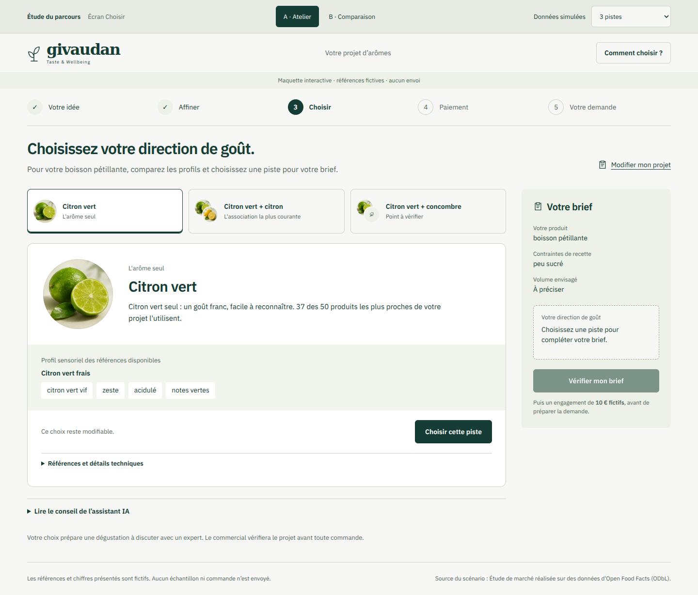
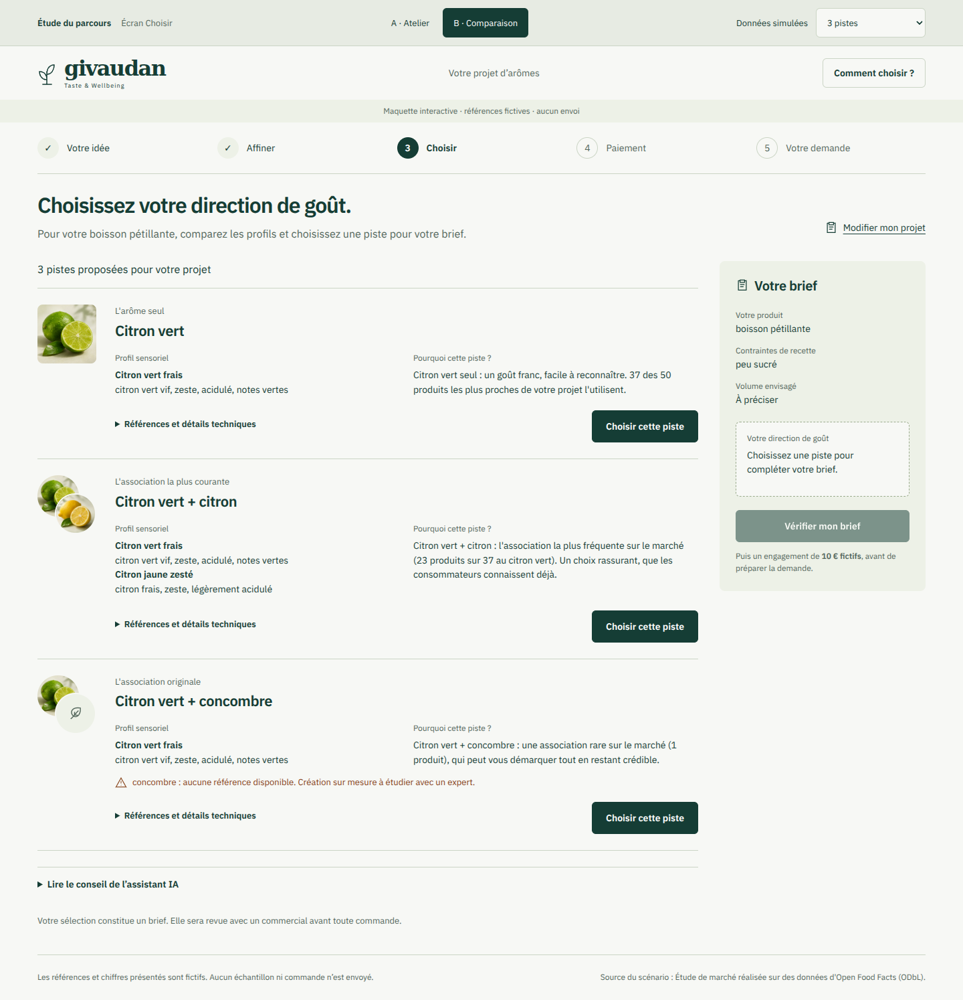

# Étude de l’écran Choisir

Deux maquettes interactives du ticket #33 permettent de comparer l’organisation
des mêmes propositions avant de retenir une direction pour les composants
React/Tailwind du prototype #28.

- **Atelier** : explorer une proposition, lire son profil puis l’ajouter au brief.
- **Comparaison** : lire les profils et explications de toutes les propositions,
  puis choisir. Les réserves restent visibles avant la sélection.

## Ouvrir les maquettes

Depuis cette branche :

```bash
npm ci
npm run dev -w web
```

Ouvrir `http://localhost:5173/explorations/atelier/`. Le paramètre `vue` accepte
`atelier` et `comparaison`. Les liens de la barre de revue changent de variante
en conservant le choix. Le menu permet de vérifier une, deux ou trois pistes,
un label manquant, des images absentes, des textes longs, le vide et une erreur.

## Captures de revue

[Atelier sur ordinateur](previews/atelier-ordinateur.png) et
[comparaison sur ordinateur](previews/comparaison-ordinateur.png) :





Les versions mobiles sont également consultables :
[atelier](previews/atelier-mobile.png) et [comparaison](previews/comparaison-mobile.png).

## Serveur statique

Un serveur statique suffit également, sans dépendance supplémentaire :

```bash
python3 -m http.server 5183 --directory web --bind 127.0.0.1
```

Ouvrir alors `http://localhost:5183/explorations/atelier/`.

Ces fichiers HTML/CSS/JavaScript sont des maquettes de revue autonomes. Ils ne
remplacent pas l’application React/Tailwind et ne sont pas ajoutés aux entrées du
build Vite. Aucun changement du lockfile, des dépendances, des routes API ou du
prototype #28 n’est nécessaire pour les examiner. Le plan, la validation et les
résultats sont suivis dans [le ticket #33](https://github.com/Givaudan-Hackathon/hackathon-app/issues/33).

## Périmètre des interactions

La sélection complète le brief, la relecture s’ouvre dans un dialogue natif et
les champs du projet sont modifiables en mémoire. Une modification effective
annule la sélection ; une fermeture ou une sauvegarde sans changement la garde.
Sur mobile, une action de relecture apparaît à côté de la piste sélectionnée,
sans obliger à rejoindre le panneau du brief situé après les propositions.
Les profils sensoriels, les références absentes et les labels manquants sont
affichés avant le choix ; les codes, formes et labels des références DEMO sont
consultables dans les détails techniques.

Les étapes antérieures ouvrent l’éditeur du brief. Les étapes Paiement et Votre
demande servent de repères : elles ne sont pas navigables dans cette étude. La
relecture annonce les **10 € fictifs** et la validation commerciale à venir,
puis permet de revenir aux propositions. Aucun paiement ni envoi n’est simulé
par ces maquettes, et aucune demande n’est transmise.

Les changements locaux du brief ne recalculent pas les propositions. Les
variantes partagent la même fixture ; aucun moteur métier ou appel au modèle
IA n’est ajouté. Le rafraîchissement réinitialise les saisies et la sélection.

## Sources et actifs

`pistes.json` est une réponse à un parcours fictif observé sur l’API Data le
12 novembre 2026 (`v2.2.4-revue`), avec un identifiant de session remplacé.
Les références et chiffres de cet exemple sont fictifs ; l’attribution Data
est conservée. Les scénarios de revue dérivent cet exemple dans le navigateur :
limitation à une ou deux pistes, ajout explicite d’un label bio manquant,
absence d’images, texte de test, vide ou erreur. Ces variantes ne constituent
pas de nouvelles réponses du backend ni une preuve d’intégration Nest.

Les illustrations citron vert et citron sont réutilisées depuis le commit
`4995e4a` du prototype #28. Elles ont été générées avec image_gen le
12 novembre ; leurs prompts sont dans `web/src/assets/README.md` de cette PR.
Elles ne représentent pas des références commerciales Givaudan. Pour le
concombre, la maquette affiche un remplacement neutre sans inventer de visuel.

La police IBM Plex Sans 400/600 provient de `@fontsource/ibm-plex-sans` présent
dans le prototype ; sa licence OFL est conservée dans `assets/FONT-LICENSE.txt`.
Les actifs sont servis localement. Aucun CDN, suivi ou script tiers n’est chargé.

La conception applique [Interface Design](https://github.com/Dammyjay93/interface-design/blob/2f9be3206855bcb2d1d0af262c8bae25cba6658d/.claude/skills/interface-design/SKILL.md)
et les trois skills UI déjà requis. Les décisions finales et leur généralisation
restent soumises à la comparaison des variantes.
